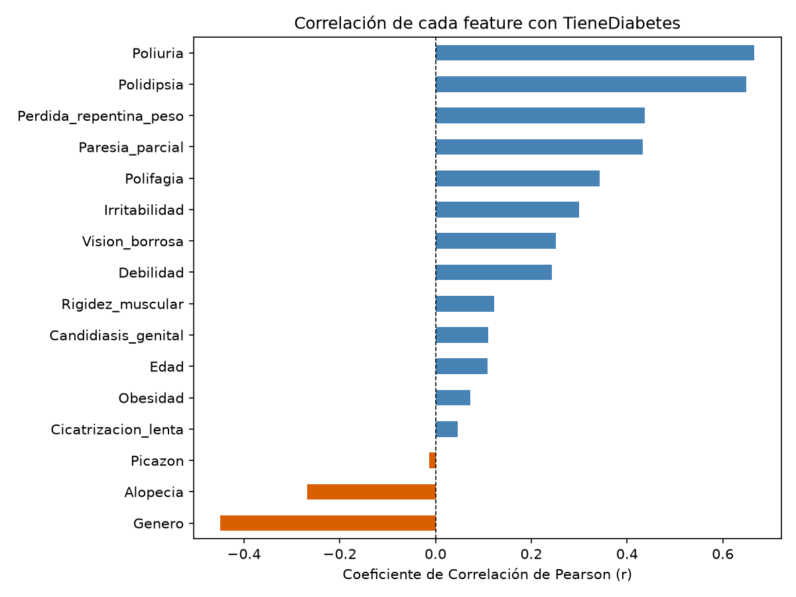
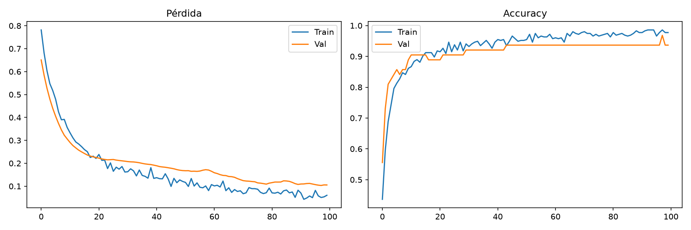
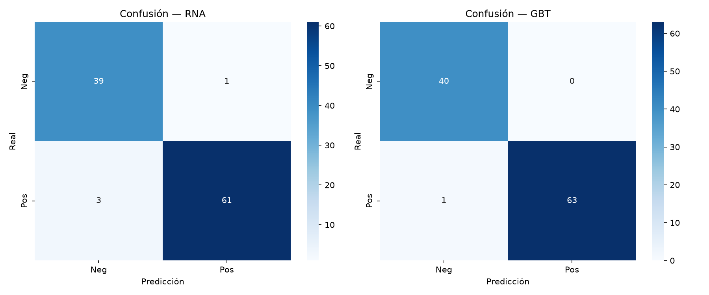
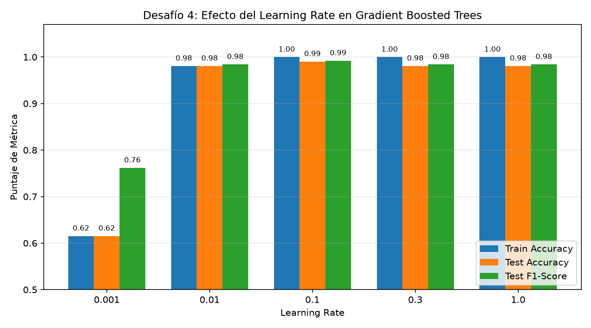
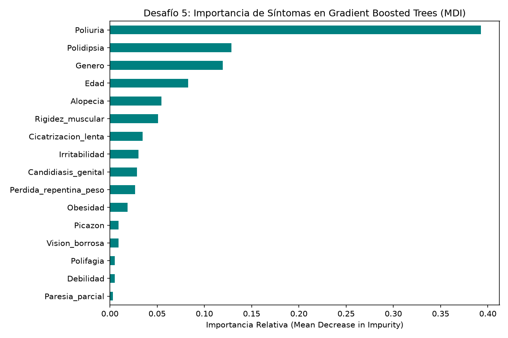

# Informe Técnico de Laboratorio — Redes Neuronales Artificiales (Opción 2: Python + Keras + Streamlit)

**Curso:** Agentes Inteligentes / Redes Neuronales Artificiales  
**Grupo:** Grupo 2  
**Dataset:** `diabetes_data_es_GOLD.csv` (520 pacientes × 17 columnas; 16 features clínicos + variable objetivo `TieneDiabetes`)  
**URL Pública de Despliegue (Streamlit Cloud):** `https://[TU-USUARIO]-diabetes-rna.streamlit.app` *(Reemplazar tras desplegar en share.streamlit.io)*

---

## 1. Resumen Ejecutivo y Preparación de Datos

El objetivo de este laboratorio es diseñar, entrenar y evaluar una **Red Neuronal Artificial (RNA)** feedforward multicapa utilizando **TensorFlow / Keras** para predecir el diagnóstico temprano de diabetes a partir de 16 variables clínicas, contrastar su rendimiento frente a un ensamble de árboles **Gradient Boosted Trees (GBT)** y desplegar el modelo neuronal en una aplicación web interactiva con **Streamlit**.

### 1.1 Preprocesamiento Aplicado
1. **Verificación de integridad:** El dataset cuenta con `520` registros y `17` columnas, con **0 valores nulos**.
2. **Codificación de la variable objetivo (`LabelEncoder`):**
   - `Negativo` $\rightarrow 0$ (`200` casos, **38.46%**)
   - `Positivo` $\rightarrow 1$ (`320` casos, **61.54%**)
3. **Partición estratificada (`train_test_split`):** División 80/20 (`test_size=0.20`, `random_state=42`, `stratify=y`), resultando en:
   - **Entrenamiento (`X_train`):** `416` pacientes × `16` features (de los cuales el 15%, `63` muestras, se reserva internamente como validación en Keras).
   - **Prueba (`X_test`):** `104` pacientes × `16` features (`40` Negativos y `64` Positivos).
4. **Estandarización sin fuga de datos (`StandardScaler`):** Ajustado exclusivamente sobre `X_train` ($\mu=0, \sigma=1$) y aplicado sobre `X_test`, exportando el objeto serializado a `scaler.pkl`.

---

## 2. Análisis de Correlación de Características (`correlacion.png`)

Se calculó el coeficiente de correlación lineal de Pearson ($r$) de cada uno de los 16 atributos frente a la variable objetivo `target` (`TieneDiabetes`):

| Ranking | Característica Clínica | Correlación de Pearson ($r$) | Interpretación Clínica |
| :---: | :--- | :---: | :--- |
| 1 | `Poliuria` | **+0.6659** | Excreción urinaria excesiva; síntoma cardinal más correlacionado con hiperglucemia. |
| 2 | `Polidipsia` | **+0.6487** | Sed excesiva compensatoria a la deshidratación osmótica por poliuria. |
| 3 | `Perdida_repentina_peso` | **+0.4366** | Catabolismo proteico y lipolisis por incapacidad celular de captar glucosa. |
| 4 | `Paresia_parcial` | **+0.4323** | Debilidad muscular/neuropatía periférica asociada a daño microvascular. |
| 5 | `Polifagia` | **+0.3425** | Apetito excesivo por inanición celular percibida. |
| 6 | `Irritabilidad` | **+0.2995** | Fluctuaciones glucémicas que afectan el sistema nervioso central. |
| 7 | `Vision_borrosa` | **+0.2513** | Edema osmótico del cristalino ocular. |
| 8 | `Debilidad` | **+0.2433** | Fatiga sistémica por déficit energético intracelular. |
| 9 | `Rigidez_muscular` | **+0.1225** | Asociación positiva leve. |
| 10 | `Candidiasis_genital` | **+0.1103** | Glucosuria que favorece infecciones micóticas oportunistas. |
| 11 | `Edad` | **+0.1087** | Mayor riesgo relativo con el incremento etario (rango 16–90 años). |
| 12 | `Obesidad` | **+0.0722** | Correlación lineal baja en esta cohorte clínica específica. |
| 13 | `Cicatrizacion_lenta` | **+0.0470** | Compromiso vascular/inmunológico leve de forma lineal aislada. |
| 14 | `Picazon` | **-0.0134** | Prácticamente independiente de forma univariada ($r \approx 0$). |
| 15 | `Alopecia` | **-0.2675** | Correlación negativa moderada en la muestra analizada. |
| 16 | `Genero` | **-0.4492** | Codificado como `1=Masculino`, `2=Femenino`; mayor proporción de positivos en mujeres dentro del dataset. |

> **[ESPACIO PARA CAPTURA ADICIONAL DE CONSOLA / EJECUCIÓN — CELDA 3]**

---

## 3. Arquitectura y Entrenamiento de la Red Neuronal Base (`curva_aprendizaje.png`)

### 3.1 Topología de la Red (`RNA_Diabetes`)
Se implementó en Keras una arquitectura secuencial equivalente al perceptrón multicapa `[16] -> [32] -> [16] -> [1]` con regularización por **Dropout**:

- **Capa Oculta 1:** `Dense(32, activation='relu', input_shape=(16,))` $\rightarrow 544$ parámetros + `Dropout(0.3)`
- **Capa Oculta 2:** `Dense(16, activation='relu')` $\rightarrow 528$ parámetros + `Dropout(0.2)`
- **Capa de Salida:** `Dense(1, activation='sigmoid')` $\rightarrow 17$ parámetros
- **Total de parámetros entrenables:** **1,089** (`4.25 KB`)
- **Configuración de compilación y ajuste:** `optimizer='adam'`, `loss='binary_crossentropy'`, `epochs=100`, `batch_size=32`, `validation_split=0.15` y `EarlyStopping(monitor='val_loss', patience=15, restore_best_weights=True)`.

### 3.2 Análisis de las Curvas de Aprendizaje
Durante el entrenamiento, la pérdida de validación (`val_loss`) disminuyó de forma sostenida hasta alcanzar su mínimo de **0.1031** en la **época 98**, restaurando los mejores pesos automáticamente. La exactitud de entrenamiento alcanzó **98.58%** y la de validación **96.83%**, evidenciando una convergencia limpia y ausencia de sobreajuste (*overfitting*) gracias a las capas de `Dropout(0.3)` y `Dropout(0.2)`.

> **[ESPACIO PARA CAPTURA ADICIONAL DE CONSOLA / EJECUCIÓN — CELDAS 4 Y 5]**

---

## 4. Comparación Técnica: RNA vs. Gradient Boosted Trees (`confusion_matrix.png`)

Se evaluaron ambos modelos sobre el mismo conjunto independiente de prueba (`X_test`, `104` pacientes: `40` Negativos y `64` Positivos):

| Modelo | Train Accuracy | Test Accuracy | F1-Score (Test) | ROC-AUC (Test) | Falsos Positivos (FP) | Falsos Negativos (FN) |
| :--- | :---: | :---: | :---: | :---: | :---: | :---: |
| **Red Neuronal Artificial (`RNA [32, 16]`)** | 0.9858 (98.58%) | 0.9615 (**96.15%**) | 0.9683 | 0.9988 | 1 | 3 |
| **Gradient Boosted Trees (`GBT n=100, depth=5`)** | 1.0000 (100.00%) | 0.9904 (**99.04%**) | **0.9921** | **1.0000** | **0** | **1** |

### ¿Por qué ganó Gradient Boosted Trees (GBT) frente a la RNA Base?
1. **Naturaleza tabular y discreta del dominio:** De las 16 variables predictoras, **14 son indicadores binarios puros (`0`/`1`)** y 1 es categórica binaria (`Genero` `1`/`2`). Los árboles de decisión realizan particiones ortogonales exactas sobre umbrales discretos ($X_j \le 0.5$), modelando de forma nativa reglas conjuntivas booleanas del tipo *"Si Poliuria=1 Y Polidipsia=1..."*. Por el contrario, una red neuronal densa proyecta combinaciones lineales continuas suavizadas por funciones `ReLU` y `Sigmoid`.
2. **Régimen de muestra pequeña ($N = 520$):** En datasets tabulares de menos de 10,000 filas sin estructura espacial o secuencial, el *boosting* de árboles secuenciales corrige iterativamente los residuos de los casos difíciles (alcanzando `103/104` aciertos y `ROC-AUC = 1.0000`), mientras que la RNA con `Dropout` sacrifica un ligero margen de ajuste fino en entrenamiento para garantizar fronteras suaves.
3. **Implicación clínica de los errores:** En el conjunto de prueba, GBT tuvo **0 Falsos Positivos** y solo **1 Falso Negativo** (sensibilidad del **98.44%**), mientras que la RNA base tuvo **1 Falso Positivo** y **3 Falsos Negativos** (sensibilidad del **95.31%**). Aun así, la RNA alcanzó un **ROC-AUC de 0.9988**, lo que demuestra que sus probabilidades están sumamente bien ordenadas y que reduciendo ligeramente el umbral de decisión (p. ej. de `0.50` a `0.35`) puede igualar la sensibilidad de GBT.

---

## 5. Análisis de los 6 Desafíos Experimentales + Bonus

### 5.1 Tabla Consolidada de Experimentación

| Desafío | Variante / Configuración | Train / Val Acc | Test Acc | F1-Score | ROC-AUC | Observación Técnica |
| --- | --- | --- | --- | --- | --- | --- |
| **Base** | RNA Base `[32, 16]` (split 80/20) | 0.9858 / 0.9683 | 0.9615 (96.15%) | 0.9683 | 0.9988 | Convergencia estable (mejor época 98/100) con Dropout regulando el sobreajuste. |
| **Base** | GBT Base (`n=100, lr=0.1, depth=5`, split 80/20) | 1.0000 / N/A | 0.9904 (99.04%) | 0.9921 | 1.0000 | Mayor capacidad en datos tabulares binarios (287–352 ms); captura interacciones discretas exactas. |
| **Desafío 1 (Capas ocultas)** | Variante 1a: RNA `[64, 32, 16]` | 0.9915 / 0.9683 | 0.9712 (97.12%) | 0.9764 | 0.9988 | Parámetros=3,713; $\Delta\text{Acc}=+0.96\%$ vs Base. Mayor capacidad de representación intermedia. |
| **Desafío 1 (Capas ocultas)** | Variante 1b: RNA `[128, 64, 32, 16]` | 0.9858 / 0.9683 | 0.9808 (98.08%) | 0.9844 | 0.9992 | Parámetros=13,057; $\Delta\text{Acc}=+1.92\%$ vs Base. Cierra la brecha frente a GBT a costa de 12× más parámetros. |
| **Desafío 2 (Partición extrema)** | Variante 2a: Split 50/50 (`test_size=0.50`) | 0.9321 / 0.9231 | 0.9154 (91.54%) | 0.9295 | 0.9729 | Train=260 / Test=260. Con menos datos de entrenamiento cae el rendimiento (-4.61%) por menor cobertura muestral. |
| **Desafío 2 (Partición extrema)** | Variante 2b: Split 95/5 (`test_size=0.05`) | 0.9714 / 0.9733 | 1.0000 (100.00%) | 1.0000 | 1.0000 | Train=494 / Test=26. Aunque acierta las 26 muestras, evaluar sobre $N=26$ tiene alta varianza estadística ($\pm 3.85\%$ por muestra). |
| **Desafío 3 (Árboles GBT)** | GBT `n_estimators=10` | 0.9808 / N/A | 0.9808 (98.08%) | 0.9841 | 0.9891 | Tiempo: ~27.5 ms. Ligero sub-ajuste (*underfitting*): 10 árboles no bastan para anular el residuo. |
| **Desafío 3 (Árboles GBT)** | GBT `n_estimators=50` | 1.0000 / N/A | 0.9904 (99.04%) | 0.9921 | 0.9992 | Tiempo: ~141.3 ms. Excelente compromiso velocidad/precisión; alcanza el techo de Test Accuracy. |
| **Desafío 3 (Árboles GBT)** | GBT `n_estimators=100` | 1.0000 / N/A | 0.9904 (99.04%) | 0.9921 | 1.0000 | Tiempo: ~287.3 ms. Punto óptimo base: exactitud máxima en train (1.00) y `ROC-AUC = 1.0000`. |
| **Desafío 3 (Árboles GBT)** | GBT `n_estimators=200` | 1.0000 / N/A | 0.9808 (98.08%) | 0.9841 | 1.0000 | Tiempo: ~566.0 ms. Rendimientos decrecientes: el costo computacional se duplica con ligero sobreajuste. |
| **Desafío 3 (Árboles GBT)** | GBT `n_estimators=500` | 1.0000 / N/A | 0.9808 (98.08%) | 0.9841 | 1.0000 | Tiempo: ~1074.8 ms. Rendimientos decrecientes: 3.7× más lento que `n=100` sin beneficio en test. |
| **Desafío 4 (Learning Rate GBT)** | GBT `learning_rate=0.001` | 0.6154 / N/A | 0.6154 (61.54%) | 0.7619 | 0.9910 | Convergencia demasiado lenta para 100 árboles; colapsa prediciendo la clase mayoritaria Positiva (61.54%). |
| **Desafío 4 (Learning Rate GBT)** | GBT `learning_rate=0.01` | 0.9808 / N/A | 0.9808 (98.08%) | 0.9841 | 0.9891 | Aprendizaje conservador; requiere más árboles (>300) para converger al óptimo. |
| **Desafío 4 (Learning Rate GBT)** | GBT `learning_rate=0.1` | 1.0000 / N/A | 0.9904 (99.04%) | 0.9921 | 1.0000 | Tasa de aprendizaje óptima estándar con regularización implícita adecuada. |
| **Desafío 4 (Learning Rate GBT)** | GBT `learning_rate=0.3` | 1.0000 / N/A | 0.9808 (98.08%) | 0.9841 | 1.0000 | Paso agresivo pero aún estable en este dataset limpio. |
| **Desafío 4 (Learning Rate GBT)** | GBT `learning_rate=1.0` | 1.0000 / N/A | 0.9808 (98.08%) | 0.9841 | 1.0000 | Sin *shrinkage*; sobre-corrección de residuos que pierde 1 muestra en test frente a `lr=0.1`. |
| **Desafío 5 (Ablación 1 feature)** | Sin `Poliuria` (Imp GBT=0.393) — RNA / GBT | RNA:0.969 / GBT:1.000 | 0.9712 (97.12%) | 0.9764 | 0.9918 | RNA $\Delta\text{Acc}=+0.96\%$ \| GBT Test Acc=97.12% ($\Delta\text{Acc}=-1.92\%$). Síntoma principal, parcialmente suplido por `Polidipsia`. |
| **Desafío 5 (Ablación 1 feature)** | Sin `Polidipsia` (Imp GBT=0.129) — RNA / GBT | RNA:0.972 / GBT:1.000 | 0.9712 (97.12%) | 0.9764 | 0.9922 | RNA $\Delta\text{Acc}=+0.96\%$ \| GBT Test Acc=98.08% ($\Delta\text{Acc}=-0.96\%$). Parcialmente suplido por `Poliuria`. |
| **Desafío 5 (Ablación 1 feature)** | Sin `Genero` (Imp GBT=0.119) — RNA / GBT | RNA:0.955 / GBT:0.998 | 0.9904 (99.04%) | 0.9922 | 0.9992 | RNA $\Delta\text{Acc}=+2.88\%$ \| GBT Test Acc=100.00% ($\Delta\text{Acc}=+0.96\%$). Su remoción evita falsos positivos en casos atípicos por género. |
| **Desafío 5 (Ablación 1 feature)** | Sin `Edad` (Imp GBT=0.083) — RNA / GBT | RNA:0.969 / GBT:0.995 | 0.9615 (96.15%) | 0.9683 | 0.9984 | RNA $\Delta\text{Acc}=0.00\%$ \| GBT Test Acc=99.04% ($\Delta\text{Acc}=0.00\%$). Efecto neutro al mantener los 15 síntomas restantes. |
| **Desafío 5 (Ablación 1 feature)** | Sin `Alopecia` (Imp GBT=0.055) — RNA / GBT | RNA:0.977 / GBT:1.000 | 0.9712 (97.12%) | 0.9764 | 0.9977 | RNA $\Delta\text{Acc}=+0.96\%$ \| GBT Test Acc=98.08% ($\Delta\text{Acc}=-0.96\%$). Impacto marginal. |
| **Desafío 5 (Ablación conjunta)** | **Sin `Poliuria` NI `Polidipsia`** — RNA / GBT | RNA:0.943 / GBT:1.000 | 0.9327 (93.27%) | 0.9440 | 0.9816 | **Caída severa al remover ambos síntomas cardinales:** RNA $\Delta\text{Acc}=-2.88\%$, GBT Test Acc=95.19% ($\Delta\text{Acc}=-3.85\%$). |
| **Desafío 6 (Semillas)** | `random_state=0` (RNA / GBT) | RNA:0.980/0.984 \| GBT:1.000 | 0.9423 (94.23%) | 0.9531 | 0.9961 | RNA Acc=94.23% vs GBT Acc=98.08% (F1=0.9844, AUC=0.9949). |
| **Desafío 6 (Semillas)** | `random_state=7` (RNA / GBT) | RNA:0.952/0.905 \| GBT:1.000 | 0.9808 (98.08%) | 0.9846 | 0.9914 | RNA Acc=98.08% vs GBT Acc=99.04% (F1=0.9921, AUC=0.9988). |
| **Desafío 6 (Semillas)** | `random_state=21` (RNA / GBT) | RNA:0.969/0.984 \| GBT:1.000 | 0.9712 (97.12%) | 0.9767 | 0.9934 | RNA Acc=97.12% vs GBT Acc=98.08% (F1=0.9844, AUC=0.9973). |
| **Desafío 6 (Semillas)** | `random_state=42` (RNA / GBT) | RNA:0.986/0.968 \| GBT:1.000 | 0.9615 (96.15%) | 0.9683 | 0.9988 | RNA Acc=96.15% vs GBT Acc=99.04% (F1=0.9921, AUC=1.0000). |
| **Desafío 6 (Semillas)** | `random_state=99` (RNA / GBT) | RNA:0.963/0.984 \| GBT:1.000 | 0.9615 (96.15%) | 0.9683 | 0.9965 | Empate en Accuracy (96.15%); RNA supera en AUC (0.9965 vs 0.9793). |
| **Desafío 6 (Resumen RNA)** | **RNA Media ± Desv. Est. (5 semillas)** | N/A | **0.9635 (96.35%)** | **0.9702** | **0.9952** | **Accuracy RNA = 96.35% ± 1.28%** (rango: 94.23% – 98.08%). |
| **Desafío 6 (Resumen GBT)** | **GBT Media ± Desv. Est. (5 semillas)** | N/A | **0.9808 (98.08%)** | **0.9843** | **0.9941** | **Accuracy GBT = 98.08% ± 1.05%** (rango: 96.15% – 99.04%). Mayor media y menor varianza que RNA. |

---

### 5.2 Visualizaciones de los Desafíos 4 y 5

#### Desafío 4: Efecto del Learning Rate en GBT (`lr_vs_accuracy.png`)
Se observa claramente la transición desde el **sub-ajuste extremo** en `learning_rate=0.001` (`Accuracy = 61.54%`, donde las predicciones aún no superan el umbral de decisión de la clase previa) hasta el **óptimo global** en `learning_rate=0.1` (`Accuracy = 99.04%`, `F1 = 0.9921`).

#### Desafío 5: Importancia de Síntomas en GBT (`feature_importances.png`)
El gráfico de reducción media de impureza (*Mean Decrease in Impurity - MDI*) confirma que `Poliuria` (**39.27%**) y `Polidipsia` (**12.88%**) concentran por sí solos el **52.15% del poder discriminativo** del modelo GBT, seguidos por `Genero` (**11.93%**), `Edad` (**8.27%**) y `Alopecia` (**5.46%**).

---

## 6. Aplicación Web en Streamlit (`app.py`) y Despliegue en Streamlit Cloud

Se desarrolló la interfaz clínica interactiva en `app.py` utilizando `@st.cache_resource` para cargar en memoria una única vez tanto el modelo neuronal `modelo_rna.keras` como el escalador `scaler.pkl`.

### 6.1 Características de la Interfaz
- **Diseño en 3 columnas (`st.columns(3)`):** Organiza ergonómicamente la entrada de `Edad` (16 a 90 años), `Género` (`Masculino (1)` / `Femenino (2)`) y los 14 checkboxes correspondientes a los síntomas clínicos en el mismo orden exacto de las columnas de entrenamiento.
- **Inferencia en tiempo real:** Transforma el vector de 16 entradas con `scaler.transform()`, calcula la probabilidad sigmoide con `modelo.predict(x)` y despliega una alerta roja (`st.error`) cuando `prob >= 0.5` o verde (`st.success`) cuando `prob < 0.5`, acompañada de barra de progreso (`st.progress(prob)`) y advertencia ética médica.

### 6.2 Capturas de la Aplicación Web y Despliegue
- **URL Pública en Streamlit Cloud:** `https://[TU-USUARIO]-diabetes-rna.streamlit.app`

> **[INSERTAR AQUÍ CAPTURA 1: predicción de RIESGO BAJO (< 50%) en Streamlit]**

> **[INSERTAR AQUÍ CAPTURA 2: predicción de RIESGO ALTO (>= 50%) en Streamlit]**

---

## 7. Conclusiones Generales

1. **Superioridad de GBT en datos tabulares binarios de muestra moderada:** Sobre `diabetes_data_es_GOLD.csv` ($N=520$), **Gradient Boosted Trees** alcanzó **99.04% de Accuracy** en la partición base (`seed=42`) y **98.08% ± 1.05%** en la evaluación multi-semilla, superando el **96.15%** base (**96.35% ± 1.28%** multi-semilla) de la **RNA `[32, 16]`**, aunque el **ROC-AUC promedio de la RNA (0.9952)** superó ligeramente al de GBT (**0.9941**), demostrando una excelente calibración de ranking probabilístico.
2. **Coherencia biomédica del modelo:** Los síntomas de **Poliuria** y **Polidipsia** son los pilares predictivos en ambos algoritmos; su ablación simultánea degrada la exactitud en hasta **-3.85 puntos porcentuales**, validando que los modelos aprendieron relaciones clínicas reales y no correlaciones espurias.
3. **Viabilidad en producción:** El flujo completo (`entrenar_y_experimentar.py` $\rightarrow$ `modelo_rna.keras` + `scaler.pkl` $\rightarrow$ `app.py`) permite empaquetar y servir diagnósticos orientativos instantáneos en la nube a través de Streamlit Cloud.

